<h1 align="center">
  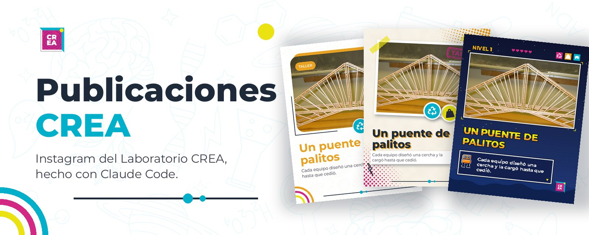
  Publicaciones CREA
</h1>

<p align="center">
  <a href="#qué-es">Qué es</a> &#xa0; | &#xa0;
  <a href="#las-piezas">Piezas</a> &#xa0; | &#xa0;
  <a href="#los-tres-estilos">Estilos</a> &#xa0; | &#xa0;
  <a href="#el-reel">Reel</a> &#xa0; | &#xa0;
  <a href="#animaciones-en-bucle">Animaciones</a> &#xa0; | &#xa0;
  <a href="#las-mascotas">Mascotas</a> &#xa0; | &#xa0;
  <a href="#flujo-de-trabajo">Flujo</a> &#xa0; | &#xa0;
  <a href="#recursos">Recursos</a> &#xa0; | &#xa0;
  <a href="#instalar">Instalar</a>
</p>

## Qué es

`publicaciones-crea` es una skill de Claude Code del Laboratorio CREA (Universidad de los Andes). Convierte las fotos y videos de un taller en una publicación de Instagram completa: la pieza visual y el caption, con la paleta, la tipografía, los íconos, Séneca y la voz del laboratorio.

Claude hace el trabajo de criterio: mira el material, elige la foto, escribe el titular y el caption, propone el estilo y revisa el resultado. El motor hace el trabajo exacto: retícula, colores, tipografía, íconos, animación y los recortes de Instagram. Así la cuenta se ve como una cuenta y no depende de quién la arme.

Es la hermana de `material-crea` (presentaciones y documentos, en [`CREA-Ingenieria/skills-crea`](https://github.com/CREA-Ingenieria/skills-crea)): comparten paleta, tipografía, Séneca y lenguaje.

> Todas las imágenes de este README salen del motor con las fotos de demostración de la skill. Las publicaciones reales usan las fotos del taller, que nunca se suben al repositorio.

## Las piezas

<p align="center">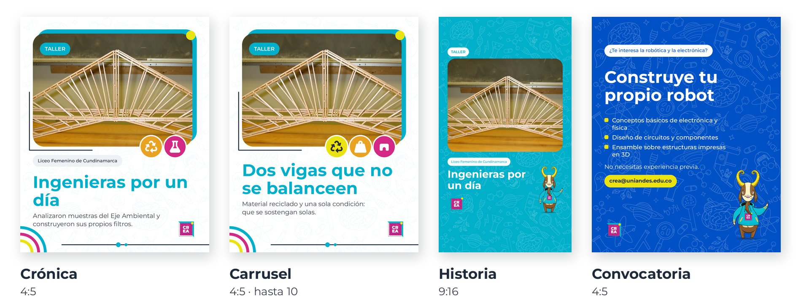</p>

| Pieza | Formato | Para qué |
|:-:|:-:|---|
| **Crónica** | 4:5 | Una publicación suelta: qué pasó en un taller, con quién y qué hicieron |
| **Carrusel** | 4:5, hasta 10 láminas | La historia completa del taller: qué se hizo → cómo → quién estuvo → gracias. Admite videos dentro del marco |
| **Historia** | 9:16 | El aviso rápido del día, con Séneca |
| **Convocatoria** | 4:5 | Abrir un taller: qué se aprende y cómo inscribirse |
| **Reel** | 9:16 | Para llegar fuera del perfil, con el contacto del laboratorio al final |

Cada entrega trae los JPG, los MP4 y el **caption listo para copiar**, con los hashtags de la cuenta.

## Los tres estilos

Los datos de la lámina son los mismos; cambia el diseño. Un carrusel va entero en un estilo y cada estilo tiene **versión estática** y **versión animada**, que termina exactamente en el diseño estático.

### Marco 🟦
|La cara diaria de la cuenta. Las formas del logo CREA: bloque de color corrido, punto amarillo, línea en L, anillos, la línea con puntos de la pared del laboratorio y los íconos de la actividad.|
|:-:|

| Estático | Animado |
|:-:|:-:|
| 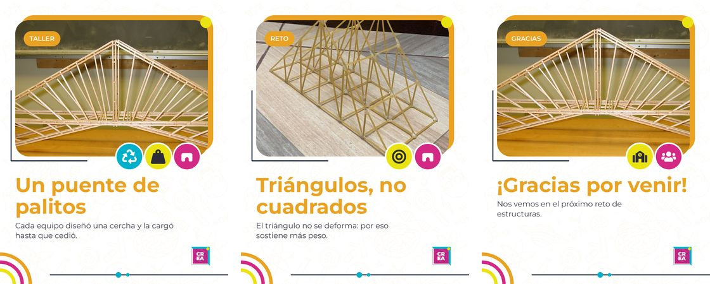 | 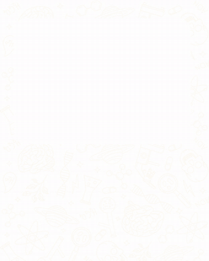 |

### Recortes ✂️
|Un collage impreso, para talleres llenos de material y manos. La foto pegada con cinta, el chip como sello de goma, los íconos como stickers y CREABOT o Séneca en la primera y la última lámina.|
|:-:|

| Estático | Animado |
|:-:|:-:|
| 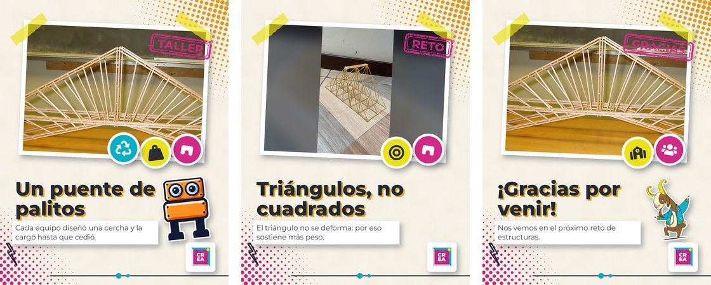 | 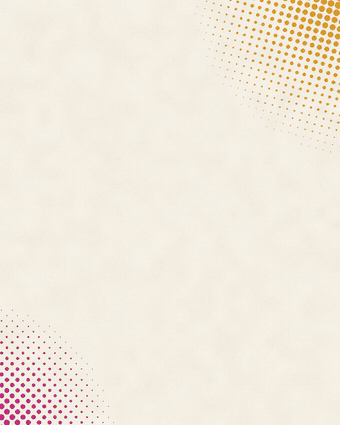 |

### Arcade 🕹️
|La pantalla del taller «CREA tu propio videojuego», para programación, robótica y público joven. Píxeles, NIVEL n, corazones, inventario con los íconos y la bajada en una caja de diálogo con CREABOT que se escribe sola.|
|:-:|

| Estático | Animado |
|:-:|:-:|
| 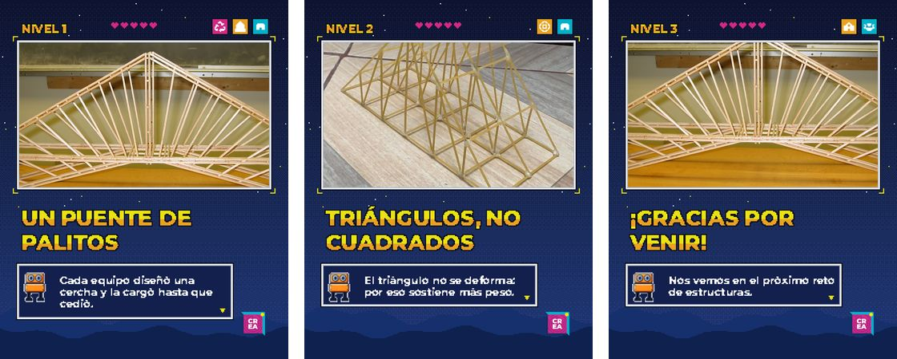 | 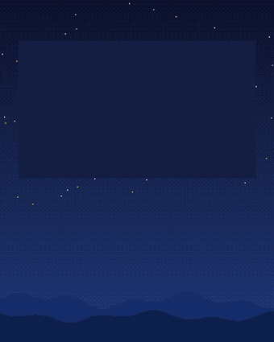 |

**La foto nunca se mueve.** Lo que se anima es el diseño: ni acercamiento ni paneo sobre las fotos, porque en un marco pequeño se ve mal.

## El reel

<table>
<tr>
<td width="290">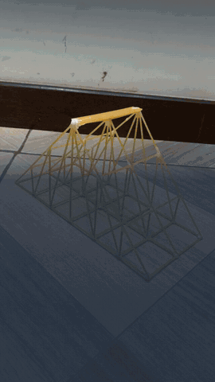</td>
<td>

Vertical, de 19,5 s, con la estructura que mejor retiene:

1. **Gancho:** el video más vivo y una pregunta.
2. **Revelación:** la foto en el marco, con quién fue y dónde.
3. **Conceptos:** «Hablamos de…» y los conceptos reales del taller, girando como un tragamonedas.
4. **Momento:** otro tramo del video.
5. **Cierre:** el agradecimiento.
6. **Contacto:** la biografía de la cuenta, tarjetas con la cuenta, el sitio y la dirección, y Séneca saludando.

Cada transición tiene una causa en pantalla: un color que sube, un bombillo que crece, un iris que se abre. El texto vive solo en la franja que no tapan los botones de Instagram.

Con acentos claros (turquesa, naranja), la letra sobre el color va oscura para que se lea.

</td>
</tr>
</table>

## Animaciones en bucle

<p align="center">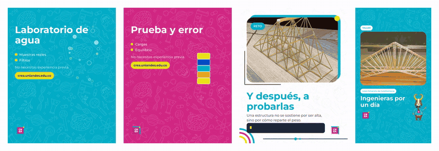</p>

| Animación | Para qué taller |
|---|---|
| **Burbujas** que suben | Agua, laboratorio, química |
| **Torre** que se balancea y se cae | Estructuras, equilibrio, prueba y error |
| **Código** que se escribe | Programación, lógica, método |
| **Séneca** que guiña | Cualquiera: es el guiño de marca |

Una por pieza y nunca en la primera lámina de un carrusel: si la primera es un video, Instagram muestra el post como reel.

## Las mascotas

Séneca y CREABOT, las mascotas insignia del laboratorio, en muchas más poses para que no salgan siempre iguales.

### CREABOT 🤖
|Redibujado en vector con las medidas y colores del original: sale nítido a cualquier tamaño y cada pose mueve sus partes. Salta, camina, piensa, celebra, se duerme, y su pecho puede ser una pantalla con un ícono, un texto o una barra de carga.|
|:-:|
| 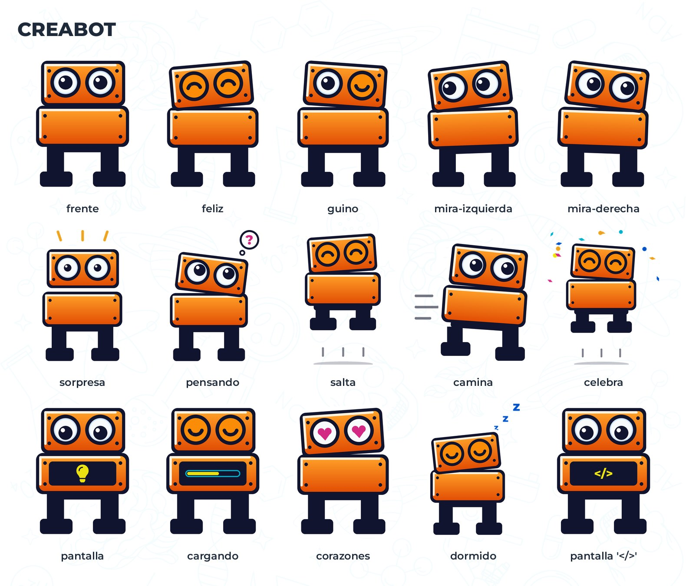 |

### Séneca 🐐
|Sus dibujos originales en más variantes: mirando hacia el otro lado (con el logo siempre legible), asomándose desde el borde, la cara en un círculo para avatares, y el buzo en el color de cada taller.|
|:-:|
| 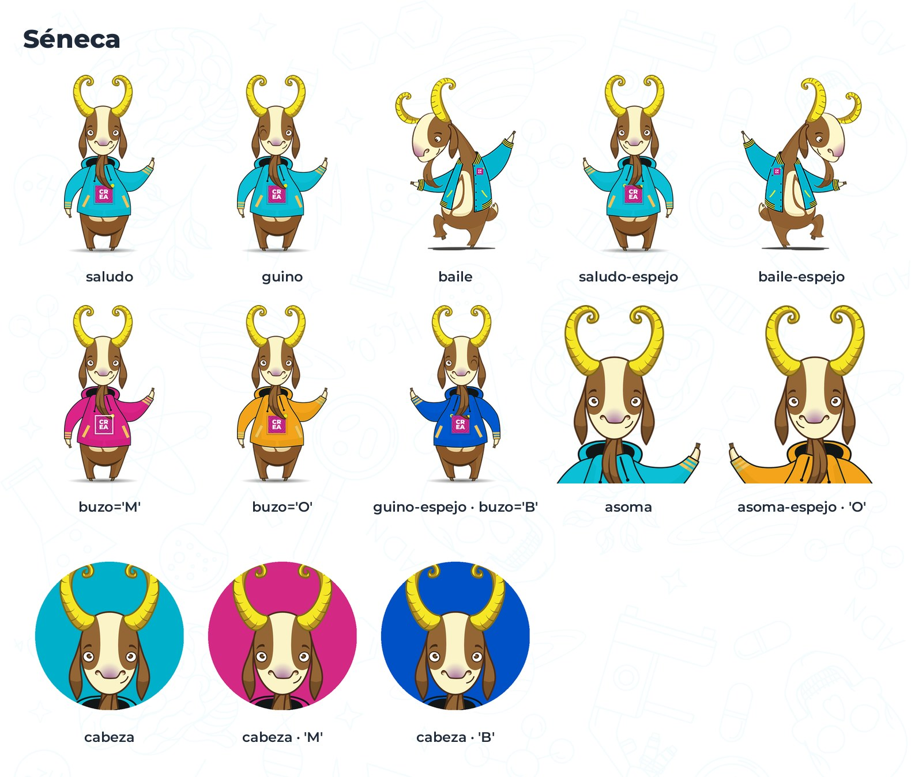 |

```python
lamina(foto, 'Un robot que sigue la luz', estilo='recortes', sticker='creabot:celebra')
p.img(creabot('pantalla', alto=300, pantalla='icono:robot'), 700, 900)
p.mascota(640, 1300, alto=520, pose='asoma', buzo='O')
```

Cuándo usar cada pose: [`referencia/personajes.md`](plugins/publicaciones-crea/skills/publicaciones-crea/referencia/personajes.md).

## Flujo de trabajo

<p align="center">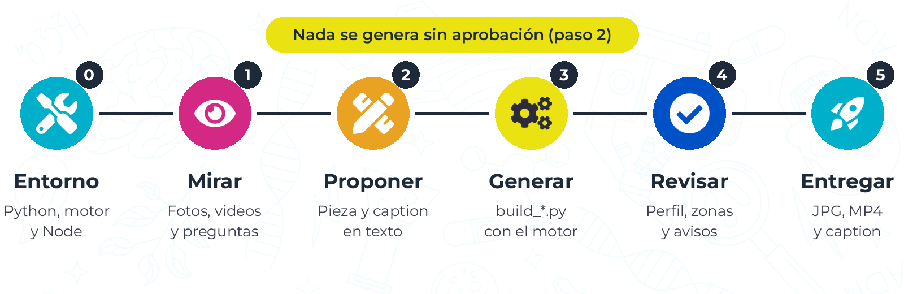</p>

0. **Entorno.** La skill revisa Python, instala el motor y mira si hay Node (sin Node, solo salen versiones estáticas).
1. **Mirar y preguntar.** Claude abre cada foto y video antes de preguntar nada, busca el taller en el set de CREA y hace **todas las preguntas en una sola tanda**, con una opción por defecto.
2. **Proponer.** Muestra en texto qué foto va en cada lámina, el titular, los íconos, el estilo y el caption completo, y dice qué dedujo y qué inventó. **Nada se genera sin aprobación.**
3. **Generar.** Escribe un `build_*.py` con el motor y lo corre.
4. **Revisar.** Mira cada pieza, el recorte del perfil y lo que tapa Instagram, y regenera hasta que no quedan avisos.
5. **Entregar.** Archivos, ubicación, etiquetas y el caption en un bloque aparte.

La frase que conviene decirle:

> **"Antes de generar nada, hazme las preguntas y muéstrame el caption."**

### Cómo decide

| Pregunta | Opciones | Por defecto |
|---|---|---|
| ¿Qué pieza? | Crónica · carrusel · historia · convocatoria · reel | Carrusel de 3 a 5 láminas si hay varias fotos buenas |
| ¿Qué estilo? | Marco · recortes · arcade | Marco, con una variante si el taller lo pide |
| ¿Estática o animada? | Estática · animada · las dos | Las dos cuando hay Node |
| ¿Reel? | Sí, cuando hay video | Lo ofrece si llegan videos |

## Revisión automática

<p align="center">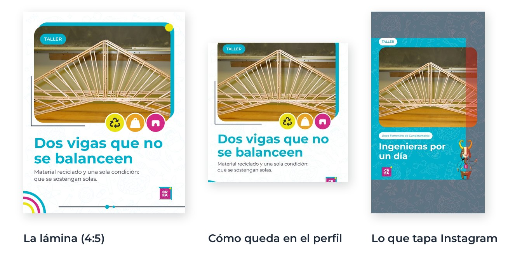</p>

Antes de entregar, el motor revisa todo junto y avisa de:

- texto fuera del cuadrado del perfil o bajo la interfaz de Instagram (en rojo en las historias);
- elementos que se tapan entre sí, títulos que se encogen, fotos de baja resolución;
- una primera lámina animada, o una publicación que subiría como reel;
- datos sin confirmar (`{validar:…}`), que en la entrega final son error;
- captions que suenan hechos en serie: frases gastadas, emojis al final de cada párrafo, cadenas de «¡».

```
⚠️ caption: frase gastada: "llenos de". Cuenta lo que pasó en vez de adornarlo
```

En las versiones animadas se suma `hyperframes check`: contraste, tiempo de lectura de cada línea y tamaño mínimo de letra.

## Recursos

Todo viene dentro del motor: no hay que instalar fuentes, ni ffmpeg, ni PowerPoint.

<p align="center">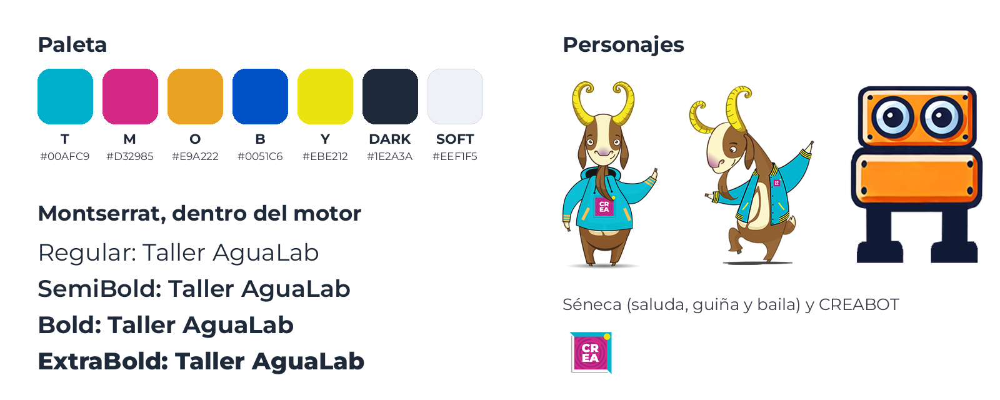</p>

**Séneca y CREABOT** en todas sus poses: ver [Las mascotas](#las-mascotas).

**68 íconos** de la actividad, en los colores de la marca:

<p align="center">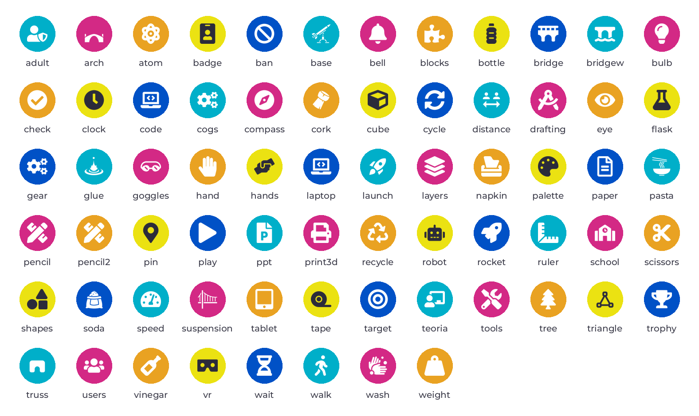</p>

**El set de CREA** ([`crea.json`](plugins/publicaciones-crea/skills/publicaciones-crea/motor/crea_publicaciones/recursos/crea.json)): lo que la skill ya sabe del laboratorio para no preguntarlo ni inventarlo. Cada dato dice si está **confirmado** o **por validar** y de dónde salió.

| | |
|---|---|
| **Talleres** | AguaLab, Mothbot, Ciencia de Cohetes, Diseñadores del Futuro, CREA tu propio videojuego… con su color, íconos y hashtags |
| **Contacto** | @crea_uniandes, crea.uniandes.edu.co, Centro de Bienvenida |
| **Biografía** | «¡Trae a tu colegio y transforma la creatividad en realidad!» |
| **Aliados** | Bancolombia (@bancolombia), SLB |
| **Hashtags** | #LaboratorioCREA, #EducaciónSTEAM, #uniandesciam, #MujeresEnSTEAM… |

## Estructura del proyecto

```
Presentaciones-Publicaciones/
│
├── .claude-plugin/marketplace.json    # Catálogo para instalar con /plugin
├── docs/readme/                       # Imágenes de este README (y el script que las genera)
│
└── plugins/publicaciones-crea/skills/publicaciones-crea/
    ├── SKILL.md                       # Las instrucciones para Claude: mapa de decisiones y flujo
    ├── referencia/                    # Guías que Claude lee según la pieza
    │   ├── personajes.md              # Séneca y CREABOT: poses y cuándo usarlas
    │   ├── estandar.md                # Formatos, retícula, paleta, Séneca
    │   ├── piezas.md                  # Las funciones del motor
    │   ├── estilos.md                 # Cómo elegir marco, recortes o arcade
    │   ├── movimiento.md              # Versiones animadas y reel
    │   ├── crea.md                    # El set de CREA
    │   ├── caption.md · voz-crea.md   # Cómo escribe la cuenta
    │   ├── revision-visual.md         # Lista de revisión y decisiones de CREA con fecha
    │   └── galeria.md                 # Ejemplos aprobados y por qué funcionan
    ├── ejemplos/                      # Scripts de ejemplo, fotos de demostración y galería
    ├── entorno/revisar.py             # Paso 0: prepara Python, el motor y revisa Node
    └── motor/crea_publicaciones/      # El motor: piezas, estilos, movimiento, personajes, caption, entrega
        └── recursos/                  # Montserrat, logo, Séneca, CREABOT, íconos, crea.json
```

## Instalar

**Antes:**

- **Claude Code** (terminal o app de escritorio).
- **Python 3.10 o más.** Si no lo tienes, la skill te dice cómo instalarlo la primera vez.
- **Node.js** (opcional), para las versiones animadas y el reel.

En Claude Code:

```
/plugin marketplace add CREA-Ingenieria/Presentaciones-Publicaciones
/plugin install publicaciones-crea@crea-publicaciones
```

Luego pásale a Claude las fotos del taller y lo que pasó, por ejemplo: *"hazme un carrusel de CREA con estas fotos del taller Mothbot con el Colegio Garcés Navas, en estilo arcade, estático y animado"*.

### Actualizar

```
/plugin marketplace update crea-publicaciones
/plugin update publicaciones-crea@crea-publicaciones
```

Después reinicia Claude Code.

### Probar sin instalar

```
claude --plugin-dir ./plugins/publicaciones-crea
```

### Llevarla a `skills-crea`

El plugin sigue la misma estructura que `material-crea`, así que puede vivir en el mismo marketplace:

1. Copia `plugins/publicaciones-crea/` a `skills-crea/plugins/`.
2. Agrega la entrada al `plugins` de `skills-crea/.claude-plugin/marketplace.json` (la misma de `.claude-plugin/marketplace.json` de este repo).
3. Agrega `publicaciones-crea` al CI de `skills-crea` (el `working-directory` de `.github/workflows/tests.yml` de este repo) y la entrada al `CHANGELOG.md`.

Desde ahí se instala con `/plugin install publicaciones-crea@crea`.

### Problemas frecuentes

| Síntoma | Qué hacer |
|---|---|
| "Python … es muy viejo" o no encuentra Python | Instala Python 3.12 (la skill te da el comando) y reinicia Claude Code |
| No abre las fotos del iPhone (HEIC) | En Windows y Mac se abren solas; si no, pide las fotos en JPG |
| `ANIMADO=no` al empezar | Instala Node.js desde https://nodejs.org; mientras tanto salen solo versiones estáticas |
| `marketplace add` falla con 404 o pide clave | Tu git no está autenticado con una cuenta de la org: `gh auth login` |

## Regenerar las imágenes de este README

Con el Python del motor y Node instalados:

```
python docs/readme/generar.py
```

Corre los ejemplos de la skill y arma el banner, las piezas, los estilos, el flujo, los recursos y los GIF. Sin Node, `--sin-animado` regenera solo lo estático.

## Proponer mejoras

Mira [CONTRIBUTING.md](CONTRIBUTING.md).

---

<p align="center">
  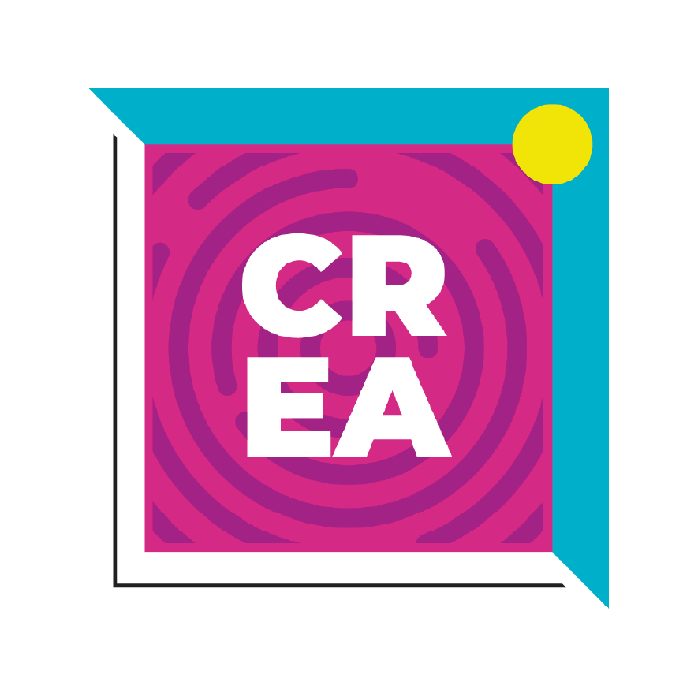
  <br>
  Laboratorio CREA · Facultad de Ingeniería · Universidad de los Andes
</p>
